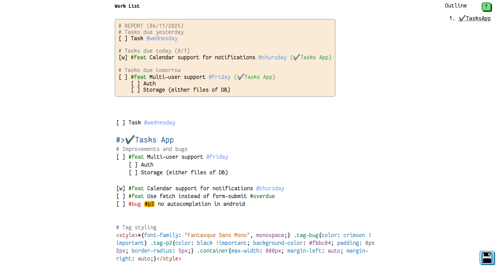

# Tasks

A scratchpad-like web application for managing and organizing tasks.

## Syntax
The syntax is inspired by the [todo.txt](http://todotxt.org/) file format, with modifications made to improve readability.

```
# this line represents a comment

#> This is a task list

#>> This is a subtask-list
# (nested under the previous task list)

[ ] to-do task
    [ ] this is a sub-task
[w] work-in-progress
[/] deferred/canceled task
[x] compleated task
    with a description

# Use `---` if the tasks below this point do not belong to any
# task list
---

[ ] A task can have a due day specified, for example @saturday. 
    Currently, due days must fall within a one-week time frame.
    -> If a task is more than two days past its due date, the 
       marker is replaced with the tag #overdue

[ ] A task can also include multiple #tags, which add context 
    and help visually distinguish different types of work 
    (e.g., #bug, #feat).
    -> Tags can be styled differently using CSS (the selector will
       be .tag-TAG_NAME)

```

## Implementation
The application uses the Flask framework for the server and stores the tasks in text files. Since it's designed as a personal scratchpad, the current implementation supports **only one user** (though it can be easily extended to multiple users).

## Deployment

> [!CAUTION]
> This application uses HTTP Basic Authentication and therefore **must be served over HTTPS**. This guide assumes the application is deployed behind a **reverse proxy** with HTTPS enabled (such as Apache or Nginx).

1. Clone de repository
2. Download the most recent release of [CodeMirror 5](https://codemirror.net/5/) and place it under `static/codemirror`
    ```
    cd static
    wget https://codemirror.net/5/codemirror.zip
    unzip codemirror.zip
    mv codemirror-5.65.20 codemirror
    ```
3. Rename `consts.sample.py` to `consts.py` and tweak the configurations
    + Generate a random string for cleanup endpoint (ex with: `openssl rand -hex 12`) and place it in the config file
    + Add username and password
4. **(optional)** If backups are enabled, create and empty git repository and add a single remote 
5. Add crontab job for the cleanup (or use other scheduling solution). Example:
    ```
    # Run every day at 23h58
    58 23 * * * curl http://localhost:8000/cleanup?code={GENERATED DAILY_CLEANUP_TRIGGER_CODE}
    ```
6. Create a new virtual environment and install the dependencies
    ```
    python3 -m venv venv
    source venv/bin/activate
    pip install -r requirements.txt
    ```
7. Start the server
    ```
    gunicorn -w 1 -p 8000 'main:app' --daemon 
    ```

## Local Developnt
Follow steps 1. to 6. (skip step 5. if not applicable).

7. Start flask server
    ```
    export FLASK_APP=main.py
    export FLASK_DEBUG=1
    flask run
    ```

## Screenshot
